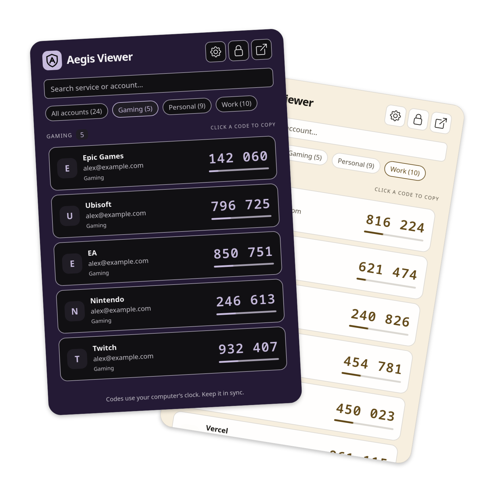

# Aegis Viewer

> **AI disclosure:** This extension was made entirely by AI.

A local Firefox extension for viewing TOTP codes from an [Aegis Authenticator](https://github.com/beemdevelopment/Aegis) JSON export.

**Unofficial third-party extension:** Aegis Viewer is not affiliated with or endorsed by the Aegis Authenticator or Firefox teams.



## Features

- **Local-only codes:** Import an Aegis JSON export and generate TOTP codes on your device, without servers, uploads, or analytics.
- **Flexible imports:** Open encrypted or unencrypted exports, with optional password protection for the saved copy of an unencrypted vault.
- **Search and groups:** Find accounts by service or account name, or filter by Aegis groups, including accounts in multiple groups.
- **Pin to top:** Pin favorite accounts to keep them first, including in searches and groups. Pins persist across reloads, Firefox restarts, and new JSON imports.
- **Live countdowns and copy:** See each code's remaining time and click a code to copy it to the clipboard.
- **Configurable locking:** Lock password-protected vaults manually, on browser restart, or after a selected timeout. Locking applies across open extension views.
- **Custom appearance:** Choose light or dark mode, use built-in color presets, or set your own background with the inline color picker or a hex value.
- **Popup and tab views:** Check codes from the toolbar popup or open the extension in a full tab.
- **TOTP compatibility:** Supports SHA-1, SHA-256, and SHA-512 with custom code lengths and periods, and shows details for skipped unsupported or invalid entries in Settings when needed.

## Load in Firefox

Requires Firefox **142 or later**.

1. Open `about:debugging#/runtime/this-firefox`.
2. Click **Load Temporary Add-on…**.
3. Select `extension/manifest.json` from this project.
4. Open the **Aegis Viewer** toolbar button. Choose **Choose Aegis JSON** to open the import tab, then select your export.
5. For an encrypted export, enter its Aegis password. For an unencrypted export, **Import without password** is selected by default. Select **Encrypt local copy** to show the password and confirmation fields if you want encryption, then select **Continue**.

The built `extension/` directory is included, so loading it requires no Node installation. Temporary add-ons are removed when Firefox restarts. To create an unsigned ZIP for temporary loading or submission to Mozilla for signing, run `npm ci` and `npm run package` (see [Develop and verify](#develop-and-verify)). Generated ZIPs are not included in the repository. Permanent installation in regular Firefox requires Mozilla signing, either listed or unlisted.

## Export from Android

In Aegis, go to **Settings → Import & export → Export**, choose **Aegis (.JSON)**, and transfer the exported file to your computer. An encrypted export is recommended. Select the local file in the extension; nothing is uploaded.

Imports are snapshots. Export and load a new file when your Android vault changes. A successful import replaces the saved vault; failed imports leave the previous saved copy intact.

## Where data is stored on your device

The original Aegis JSON file stays wherever you saved it, such as Downloads. Importing reads that file and saves a separate vault copy in the active Firefox profile; it does not move, modify, or delete the original, and the original is not needed to reopen the imported vault.

- **Saved vault and settings:** The vault is stored under the `vault` key in [`browser.storage.local`](https://developer.mozilla.org/en-US/docs/Mozilla/Add-ons/WebExtensions/API/storage/local), alongside lock, appearance, and pin preferences. This data persists across Firefox restarts and is not synced through Firefox Sync.
- **Encryption:** Encrypted Aegis exports retain their original scrypt/AES-256-GCM encryption. Choosing **Encrypt local copy** for an unencrypted export encrypts the saved copy with AES-256-GCM and PBKDF2-HMAC-SHA-256 (600,000 iterations, a random 32-byte salt and 12-byte IV). Passwords are never saved or cached. Choosing **Import without password** stores plaintext that anyone using this Firefox profile can open, including after a restart; lock controls are unavailable for that vault.
- **Unlocked vault:** For password-protected vaults, the account data needed to generate codes is cached under `unlockedVault` in Firefox's in-memory [`browser.storage.session`](https://developer.mozilla.org/en-US/docs/Mozilla/Add-ons/WebExtensions/API/storage/session). This API does not save the cache to disk. Locking, automatic lock expiry, removing the vault, restarting Firefox, or disabling/reloading the add-on clears it. The persistent copy stays encrypted. JavaScript does not guarantee immediate physical erasure of memory.

To locate the profile on disk, open `about:support` in Firefox. Under **Application Basics**, find **Profile Folder** / **Profile Directory** and select **Open Folder**, **Show in Finder**, or **Open Directory**. This gives the actual location even with a custom profile or a sandboxed installation. Typical profile locations are:

| Operating system | Profile folder                                              |
| ---------------- | ----------------------------------------------------------- |
| Linux            | `~/.mozilla/firefox/<profile>/`                             |
| Windows          | `%APPDATA%\Mozilla\Firefox\Profiles\<profile>\`             |
| macOS            | `~/Library/Application Support/Firefox/Profiles/<profile>/` |

See [Mozilla's profile-folder guide](https://support.mozilla.org/en-US/kb/profiles-where-firefox-stores-user-data) for installation-specific differences.

Firefox manages the saved copy as an IndexedDB database rather than a standalone Aegis JSON file. Its storage is typically under `<profile>/storage/default/moz-extension+++<internal-uuid>^userContextId=4294967295/idb/`; this is a Firefox implementation detail and can change. Find Aegis Viewer's **Internal UUID** on `about:debugging#/runtime/this-firefox` to identify its directory. See [Mozilla's storage directory example](https://bugzilla.mozilla.org/show_bug.cgi?id=1979997). The internal UUID is profile-specific and differs from the add-on ID `firefox-aegis@local.extension`.

**Remove vault** deletes the saved vault and unlocked cache while keeping appearance, lock, and pin preferences. It leaves the original export and any backups untouched. Keep your Aegis export as your portable backup; Firefox's internal database files are managed by the browser.

## Pinning accounts

Select the pin icon beside a code to keep that account at the top. Select it again to unpin. Pinned and unpinned accounts each keep their order from the imported file. Search and group filters still apply. Pins sync across open popup and tab views and are independent of the stars imported from Aegis.

Pins are saved locally, separately from the JSON file, and survive loading another export. Accounts are matched by their Aegis UUID, so renaming or reordering them preserves their pins. For exports without UUIDs, matching uses a SHA-256 fingerprint of the service, account name, and normalized secret; those values must stay the same. Pin preferences contain only identifiers and booleans, with no plaintext labels or secrets. Removing the saved vault keeps pin preferences so they are restored on reimport.

## Locking

For password-protected vaults, **Settings → Automatically lock vault** offers **On browser restart** (the default) or **1, 5, 15, 30, or 60 minutes**. Settings are also available from Firefox's extension preferences.

- With **On browser restart**, closing/reopening the popup, opening another view, reloading an extension page, and inactivity preserve the unlocked session. Restarting Firefox or disabling/reloading the add-on requires the password again.
- A timed lock counts from the most recent unlock or opening of an extension view. Opening a view renews the timer only while the vault is still unlocked. Changing the duration applies immediately to that timestamp; storage updates and code refreshes do not renew it.
- Timed locking runs in the background even with every extension view closed. Reopening a view also checks the deadline if Firefox delayed an alarm, for example while the computer was asleep.
- **Lock** locks all open views immediately. An expired or manually locked vault requires the password again.

## Appearance

**Settings → Appearance** offers a **Light / Dark** toggle, six presets per mode, and a custom background color. New installations start with Mint in Light mode. Selecting a preset saves its color and matching mode; the mode toggle also works independently.

Select the color swatch to open the inline hue, saturation, and lightness sliders, or enter a 3- or 6-digit hex color (with or without `#`), then select **Apply**. The chosen color is the exact background across popup and tab views; cards, inputs, and text adapt for contrast. Changes sync across open views and persist across Firefox restarts. System appearance does not override your selection.

## Privacy and compatibility

- File reading, password derivation, decryption, and TOTP generation happen on this device. There are no servers, analytics, external fonts, remote code, content scripts, or website permissions. The extension's content security policy blocks network connections.
- Clipboard access is write-only and happens when you click a code. The copied code stays in the system clipboard until you replace it; the extension does not read the clipboard or clear other clipboard content.
- Supported: TOTP with SHA-1, SHA-256, or SHA-512, custom digits and periods, Aegis file version 1 / database versions 1–3, multiple group memberships, and older named groups. Other token types (HOTP, Steam, MOTP, Yandex) and invalid entries are skipped with details in Settings. The skipped-entry section appears only when there are skipped entries. Imported icons are ignored; service initials are shown.
- Aegis encrypted imports require a password slot. Android biometric-only slots cannot be unlocked in Firefox. Imports are limited to 20 MB and 10,000 entries; scrypt parameters are bounded to avoid excessive memory/CPU usage from malformed files.
- Codes depend on your system time. Keep the computer clock synchronized.

## Develop and verify

Requires Node.js 22.14+. Packaging and the Firefox smoke test also require Python 3; the smoke test requires an installed Firefox browser.

```sh
npm ci
npm run build
```

Choose the relevant commands below when verifying changes or preparing a package:

| Command | Purpose |
| ------- | ------- |
| `npm run typecheck` | Check TypeScript and Vue templates without building. |
| `npm test` | Run unit tests for TOTP reference vectors, vault imports and encryption, sessions, lock policies, and theme contrast. |
| `npm run lint` | Run Mozilla's Add-ons Linter against the built extension. |
| `npm run test:firefox` | Build and run the Firefox integration smoke test. |
| `npm run screenshots` | Build, run the Firefox smoke test to refresh settings and import screenshots, and capture the dark/light README showcase using public demo accounts. |
| `npm run package` | Build, lint, and create `artifacts/aegis-viewer-<version>.zip`, using the manifest version. |

Every build includes typechecking. The Firefox smoke test uses a disposable headless profile and public demo secrets to check imports, password handling, code rollover, copy/filtering, locking across views and restarts, appearance settings, and removal. It never opens the user's Firefox profile. Test-only clock and lock-expiry hooks are injected into its disposable archive. Screenshots are written under `artifacts/`, including `preview.png`, `settings-preview.png`, and `settings-dark-preview.png`.

The linter fails on errors and unexpected warnings. `scripts/lint.mjs` permits only Vue's exact static-template `innerHTML` assignment, which inserts compiler-generated HTML. Mozilla's raw linter still reports that warning. Render account data through escaped interpolation; do not introduce `v-html`.

Edit application code in `src/` and styles in `src/app.scss`, then rebuild. Vite compiles Vue 3 components, TypeScript, and Sass into `extension/app.html`, `app.js`, `app.css`, and `background.js`; direct edits to those generated files are overwritten. JavaScript and CSS output remain unminified for readability. The manifest and icons are maintained directly in `extension/`. Runtime dependencies and compiled templates are bundled, so running the extension requires no package installation, runtime template compiler, or relaxed content security policy.

`src/App.vue` coordinates imports, unlocking, settings, and shared state; `src/components/AccountCard.vue` renders accounts and countdowns. Vault, TOTP, and session logic live in `src/vault.ts`, `src/totp.ts`, and `src/session.ts`. Appearance is defined in `src/theme.ts`; lock policies and alarms live in `src/settings.ts`, `src/auto-lock.ts`, and `src/background.ts`. Unit tests execute TypeScript modules directly using Node's type stripping.

## License

Aegis Viewer's own code is licensed under the [MIT License](LICENSE). The license is also included in the built extension and packaged ZIP.

Third-party components retain their respective licenses; bundled dependency and icon notices are included in [extension/THIRD_PARTY_LICENSE.txt](extension/THIRD_PARTY_LICENSE.txt). The Aegis test fixtures `tests/fixtures/upstream-plain.json` and `tests/fixtures/upstream-encrypted.json` remain separately licensed under GPL-3.0; see [tests/fixtures/LICENSE](tests/fixtures/LICENSE). These test fixtures are not included in the extension package.

## Format and test sources

- [Aegis vault format and encryption design](https://github.com/beemdevelopment/Aegis/blob/master/docs/vault.md).
- [Aegis decryption reference](https://github.com/beemdevelopment/Aegis/blob/master/docs/decrypt.py).
- `tests/fixtures/upstream-plain.json` and `upstream-encrypted.json` are public test fixtures from [Aegis's importer tests](https://github.com/beemdevelopment/Aegis/tree/master/app/src/test/resources/com/beemdevelopment/aegis/importers), distributed under Aegis's GPL-3.0 license (see `tests/fixtures/LICENSE`). Their documented test password is `test`.
- `tests/fixtures/demo.json` contains public demo secrets, not real accounts. **Never use these secrets to protect an account.**
- For manual screenshots, load [`tests/fixtures/demo-encrypted.json`](tests/fixtures/demo-encrypted.json) with password **`demo`**. It contains 24 demo accounts across Personal, Work, and Gaming groups, and no unsupported entries. All secrets are public demo data.
- [RFC 6238 Appendix B](https://www.rfc-editor.org/rfc/rfc6238#appendix-B).
- Bundled scrypt comes from `@noble/hashes`. Its MIT license and the bundled Vue packages’ MIT licenses are included in `extension/THIRD_PARTY_LICENSE.txt`.
- The settings, lock, and open-in-tab buttons use the `gear`, `lock`, and `box-arrow-up-right` SVGs from [Bootstrap Icons v1.13.1](https://github.com/twbs/icons/tree/v1.13.1/icons). Its MIT license is preserved in `licenses/bootstrap-icons-LICENSE.txt` and included in `extension/THIRD_PARTY_LICENSE.txt` on every build.
